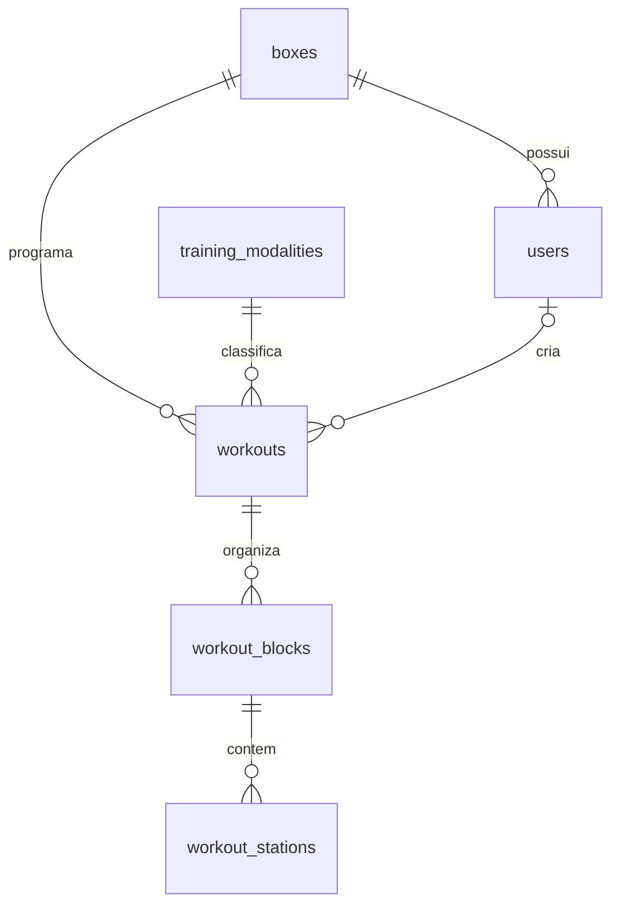

# Banco de dados

## Schema implementado

Banco MySQL compartilhado, IDs internos numéricos, isolamento lógico e constraints compostas por box. As migrations existentes foram preservadas; a Fase 2 acrescentou três migrations sem apagar dados da aplicação.

| Tabela | Campos e invariantes |
| --- | --- |
| `boxes` | id, name, head_coach_name, timezone, logo_path opcional, primary_color, secondary_color, timestamps |
| `users` | id, box_id FK, name, username global único, role, password hash, email opcional; unique(box_id,id) |
| `training_modalities` | Catálogo global: id, slug único, name; CrossFit/HYROX/Funcional |
| `workouts` | id, box_id, training_modality_id, title, scheduled_for DATE, status draft/published, structure main/full, created_by nullable, content_version, timestamps |
| `workout_blocks` | id, box_id, workout_id, type warmup/skill/workout, position, title/description/notes opcionais, timer_type, timer_settings JSON, duration_seconds nullable, timestamps |
| `workout_stations` | id, box_id, workout_block_id, position, name/description opcionais para rascunhos, distance DECIMAL (m), repetitions, load DECIMAL (kg), duration/rest/transition_seconds nullable, timestamps |

O JSON fica restrito a parâmetros variáveis do timer (`version:1`); texto, estações, datas e relações são colunas próprias. Não foi criada uma tabela extra de settings de relação 1:1, pois a configuração pertence integralmente ao bloco e não tem ciclo de vida independente. O motor implementado segue timers.md.

Índices de workout: `(box_id,scheduled_for)`, `(box_id,training_modality_id,scheduled_for)`, `(box_id,status,scheduled_for)` e unique `(box_id,id)`. Não há unicidade por dia. Blocos: unique `(box_id,id)` e `(box_id,workout_id,position)`. Estações: unique `(box_id,workout_block_id,position)`. Todas as FKs de domínio restringem exclusão; ações removem filhos pelos modelos em transação.

FKs compostas: workouts `(box_id,created_by)` → users `(box_id,id)`; blocks `(box_id,workout_id)` → workouts `(box_id,id)`; stations `(box_id,workout_block_id)` → blocks `(box_id,id)`. Assim não basta conhecer um ID de outro tenant para criar uma referência válida.

## Migrations da Fase 2 aplicadas

1. `2026_11_10_122111_add_author_and_structure_to_workouts_table`: índice composto em users, autor nullable, estrutura e índice de status/data em workouts.
2. `2026_11_10_122112_create_workout_blocks_table`: blocos ordenados, conteúdo e configuração de timer.
3. `2026_11_10_122113_create_workout_stations_table`: estações ordenadas e parâmetros próprios.

Workouts preexistentes mantêm conteúdo/IDs/status/data e recebem structure=main, created_by=null. Não é inventado um autor para dados legados. Registros publicados sem blocos podem ser consultados, mas precisam ser completados no editor para satisfazer a validação de uma nova publicação.

`users.box_id` continua nullable apenas para preservar usuários anteriores à Fase 1, que receberam username `legacy-{id}` e não podem autenticar/acessar o workspace. Auditar e vincular antes de exigir NOT NULL. Email permanece opcional porque login usa username.

## Sessões implementadas na Fase 3

Migration aditiva `2026_11_10_132606_create_workout_session_tables`, aplicada sem modificar as tabelas e configurações legadas:

| Tabela | Responsabilidade |
| --- | --- |
| `workout_sessions` | Box, workout, responsável, título/modalidade/data congelados, status da aula, bloco atual por posição, auto_advance, override de preparação, versão, aba/usuário/expiração do lease, início/fim UTC |
| `timer_sessions` | Um snapshot por bloco: tipo/título/texto/notas, configuração compilada em ms, estações congeladas, estado, acumulado em ms, início/âncora/pausa/fim UTC |
| `session_commands` | UUID, ação, hash do payload autorizado e versão de resultado para idempotência |

Novas entidades estendem TenantModel. FKs compostas por box em aula→workout, aula→responsável/controlador e timer/comando→aula. Unique(box_id,id) no pai; unique(box_id,active_workout_id) permite somente uma aula ativa por workout (null ao encerrar); unique de posição do timer na aula e de command_id na aula. Índice box/status/created_at para histórico. Eventos e timestamps têm precisão de milissegundos.

Snapshots de execução não referenciam IDs dos blocos/estações originais: editar o treino pode recriar esses filhos sem alterar a sessão. Descrições e estados ficam em colunas próprias; config e stations_snapshot usam JSON para a cópia imutável dos parâmetros de execução. Título/modalidade/data da sessão também não dependem de novas edições. FKs restritivas e ação de exclusão impedem apagar um workout com histórico de aulas; não há exclusão pública de sessões concluídas.

A criação serializa pelo workout e as transições pelo lock da sessão. O comando é registrado na mesma transação da mutação. Mudanças automáticas de estado são persistidas somente nas fronteiras, sem gravar cada segundo. Versão permite detectar concorrência, enquanto lease distingue abas autorizadas.

As configurações da box reutilizam campos existentes, sem migration para tema/logo. Upload é armazenado primeiro, alteração da box/admin em transação e remoção da logo anterior somente após commit. Em rollback, o novo arquivo é removido e o antigo permanece. Caminhos são exclusivos e restritos ao prefixo do tenant. `public/storage` usa symlink relativo neste ambiente.

## Operação

Aplicação local usa somente migrations aditivas (`artisan migrate`); não apagar volumes, bancos úteis ou executar comandos de recriação para atualizar o app. Os testes usam um banco MySQL separado chamado `testing`, protegido por TestCase antes de RefreshDatabase. Revisar migrations/backup antes de produção e solicitar autorização para ações destrutivas.

## Migration aditiva da Fase 3.1

`2026_11_10_144718_add_workout_content_versions_to_sessions` adiciona:

- workouts.content_version: unsigned integer com default 1, revisão do agregado cadastrado.
- workout_sessions.workout_version: nullable, revisão de origem capturada ao preparar novas sessões. Null nos registros anteriores, sem fingir correspondência com a revisão atual.
- workout_sessions.superseded_by_id: nullable, referência à nova sessão com FK composta por box.

A edição incrementa a revisão sob o mesmo lock/transação de título, blocos, estações e configurações. A preparação bloqueia workout e depois sessão ativa, mantendo essa ordem; comandos bloqueiam a sessão. Substituições encerram a antiga, liberam o índice de aula ativa e criam o novo snapshot na mesma transação. Nenhum timer ou comando histórico é apagado.

Esta migration não altera duration_seconds, settings, snapshots, títulos ou dados de treinos. A mudança de minutos pertence exclusivamente à entrada/apresentação dos formulários. O banco continua guardando segundos inteiros para duração dos blocos e milissegundos no contrato compilado das sessões.

## Migrations aditivas da Fase 3.2

- `2026_11_10_153006_create_box_modalities_table`: `box_id` FK boxes e `training_modality_id` FK training_modalities; unique do par, sem novos IDs de catálogo. Backfill global paginado habilita as três modalidades existentes para cada box legada com insertOrIgnore; aplicação usa somente a relação da própria box. `up()` não reaplica o backfill se a tabela já existe, preservando escolhas posteriores. Não executar o helper de backfill manualmente após a migração.
- `2026_11_10_153007_add_suggested_loads_to_workout_blocks_and_timer_sessions`: adiciona JSON nullable `suggested_loads` a blocos e timers. Exemplo: `{"equipment":"DB","rx":"22/16","intermediate":"20/14","scale":"18/12","unit":null}`. O ID do bloco já identifica a referência; não é necessário criar outra entidade para os cinco campos opcionais. Timer armazena cópia imutável; JSON não aceita IDs do cliente.

Aplicadas via migrate, sem comandos destrutivos. Nenhum tempo, conteúdo, sessão antiga ou status de workout foi reescrito. As FKs compostas existentes de blocos/timers continuam preservando a origem do tenant. Desativação remove somente a habilitação do par da própria box, sem exclusão de modalidades ou dados de treino. Novas boxes persistem a seleção na mesma transação do administrador.

## Fase 4 e hotfix de apresentação

Não criam migrations. Gestão/Aula usam as mesmas tabelas. Nova aula após execução encerrada exige confirmação vinculada ao último ID, conferida sob locks existentes; nenhuma coluna adicional necessária. Etapas opcionais são somente linhas existentes de workout_blocks ordenadas e reindexadas. Atualizações continuam transacionais via SaveWorkout; snapshots de timer_sessions permanecem independentes e não são apagados ao remover uma etapa do workout atual. Descrições não são alteradas pelo layout adaptativo. Não houve acesso ao banco de produção nesta entrega.
